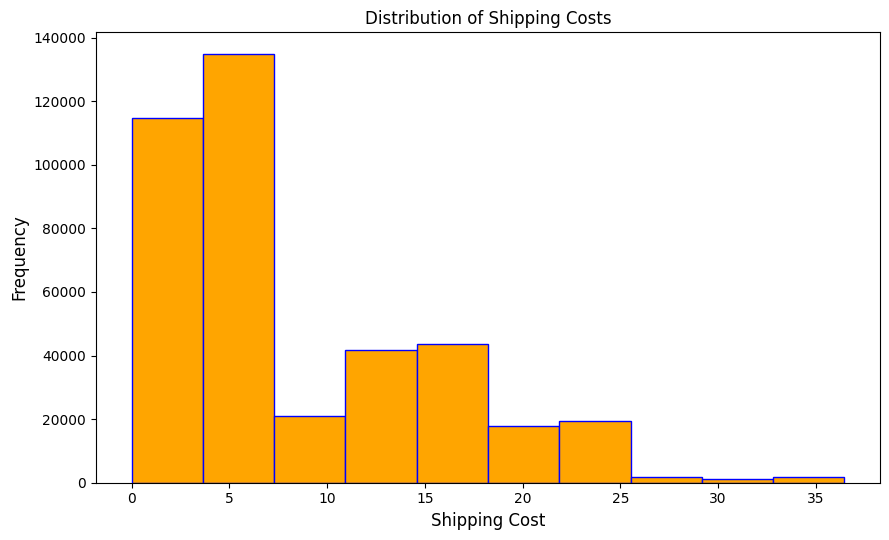
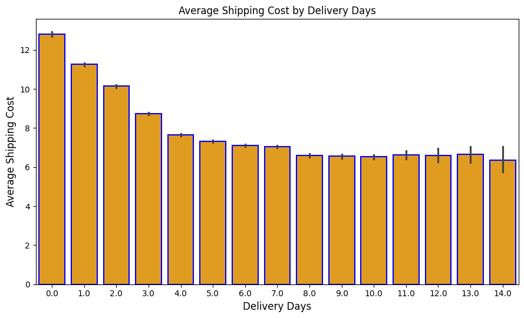
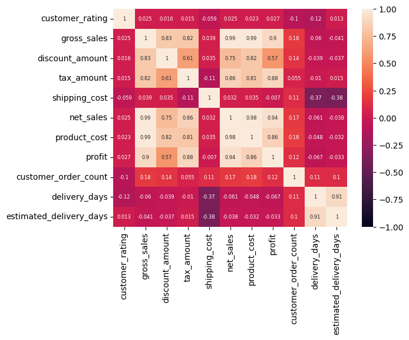
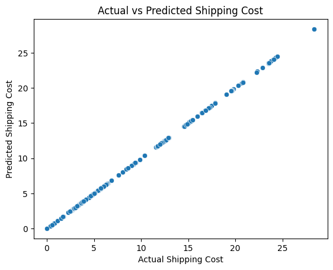

# Part 1: Predicting Shipping Cost in E-Commerce (DATA 601)

> **Can a machine learning model predict what an order will cost to ship, and does delivery speed drive that cost?**

[Back to main project](../)

**Presentation:** [View the slides (PDF)](reports/presentation.pdf)

---

## Business Problem

Shipping is one of the largest variable costs for an online store and one of the most visible costs for customers. If the business can estimate shipping cost accurately, it can:

- show customers accurate shipping prices at checkout,
- forecast per-order margins before fulfillment, and
- see whether customers who pay more actually get their orders faster.

Our goals were to **(1)** understand how shipping works at this company, **(2)** build a robust regression model for shipping cost, and **(3)** find which features matter most.

**Hypothesis:** delivery days are an important predictor, and shipping cost falls as delivery days rise (you pay more for faster delivery).

## Data

We used the Kaggle [E-Commerce Sales and Customer Analytics](https://www.kaggle.com/datasets/datascikhan/e-commerce-sales-and-customer-analytics) dataset: 138,116 synthetic orders, with 46 columns in the main sales table. We joined three tables (`sales`, `order_items`, `product_catalog`) on `order_id` / `product_id`. That gave **~397K order line items**, or **327,028 after dropping cancelled orders**, which have no delivery data.

| Type | Features |
|---|---|
| Target | `shipping_cost` |
| Numerical | `estimated_delivery_days`, `delivery_days`, `quantity`, `profit`, `gross_sales`, `discount_amount`, `tax_amount`, `net_sales`, `product_cost`, `customer_lifetime_value`, `customer_rating`, `customer_order_count` |
| Categorical (label-encoded) | `warehouse`, `shipping_method`, `delivery_status`, `customer_segment` |
| Identifier (dropped) | `order_id` |

**Data quality caveat:** The data is synthetic, likely generated with an LLM, and the source doesn't document how it was made. Its real-world validity can't be checked, so results show the method working, not real carrier pricing.

## Workflow

| Notebook | Stage | What it does |
|---|---|---|
| [`01_shipping_eda.ipynb`](notebooks/01_shipping_eda.ipynb) | Data understanding & EDA | Merges tables, computes summary statistics, plots delivery status, cost vs. speed, profit vs. cost and correlations |
| [`02_shipping_model_full_dataset.ipynb`](notebooks/02_shipping_model_full_dataset.ipynb) | Preprocessing & modelling (full data) | Drops cancelled orders, label-encodes categoricals, runs an 80/20 split, fits linear regression and computes coefficients and permutation importance. It then retrains the model without `net_sales` to see how much the predictions depend on that one column. |
| [`03_final_shipping_cost_model.ipynb`](notebooks/03_final_shipping_cost_model.ipynb) | Final analysis | The full write-up (question, data, model, interpretation, answer) on a random sample of 100 orders, with R², MAE and an actual vs. predicted plot |

Write-ups: [Final report (PDF)](reports/final_report.pdf), [Presentation (PDF)](reports/presentation.pdf)

## Exploratory Data Analysis

| Metric (n = 327,028 delivered orders) | Shipping cost | Delivery days |
|---|---|---|
| Mean | \$8.41 | 4.6 |
| Median | \$5.87 | 4.0 |
| Std. dev. | \$6.77 | 2.8 |
| Min / Max | \$0 (free) / \$36.46 | 0 (same day) / 14 |

<p align="center">
  
  
</p>

- Shipping cost is **right-skewed**. Most orders cost between \$0 and \$8 to ship, with a smaller second peak around \$15.
- Customers who pay more do get orders faster on average (deliveries in 0 to 2 days cost the most), but the effect **levels off around \$7**. Beyond that, spending more doesn't reliably buy speed.
- Estimated and actual delivery days are strongly correlated (**r = 0.92**), so the company predicts delivery times well.

<p align="center">
  
</p>

- Shipping cost has only a **weak negative correlation** with delivery days (r between -0.24 and -0.29) and almost none with anything else. On its own, no single feature looks predictive.

## Model

- **Problem type:** supervised regression with a continuous target
- **Model:** `sklearn.linear_model.LinearRegression`
- **Validation:** 80/20 train/test split (`random_state=42`). Other splits gave the same result.
- **Metrics:** R², mean absolute error, linear coefficients, permutation importance

## Results

| Model | Test R² | MAE |
|---|---|---|
| Linear regression, all features | **1.000** | ≈ \$0.00 (1.3×10⁻¹³) |
| Linear regression without `net_sales` (n = 100 sample) | 0.065 | n/a |
| Linear regression without `net_sales` (full dataset) | 0.110 | n/a |

<p align="center">
  
</p>

A perfect R² usually suggests overfitting or leakage, so we looked into why:

| Feature | Coefficient | Permutation importance |
|---|---|---|
| `net_sales` | +1.0 | 15,203 |
| `gross_sales` | -0.4 | 3,570 |
| `product_cost` | -0.6 | 2,686 |
| `profit` | -0.6 | 784 |
| `discount_amount` | +0.4 | 389 |
| `tax_amount` | -0.4 | 26 |
| `delivery_days`, `estimated_delivery_days`, `customer_rating`, `customer_lifetime_value`, `customer_order_count`, `quantity` | ≈ 0 (10⁻¹⁴ or smaller) | **0** |

The coefficients are exact, round numbers, and train and test R² were both exactly 1.0. That's the signature of a **deterministic accounting identity**, not overfitting: profit is computed *from* shipping cost, so the equation can be rearranged to solve for shipping cost from the other financial columns. The six non-financial features, **including delivery days, contribute nothing**.

## Conclusion & Business Takeaways

- **We built a model that predicts shipping cost perfectly on unseen data**, but only because it reconstructs the store's own accounting formula.
- **Our hypothesis was wrong:** delivery days have no predictive value for shipping cost in this data.
- **You don't always need a model.** When a target can be computed exactly from data you already have, a formula is simpler, faster and easier to explain than ML.
- **Watch for target leakage.** Post-transaction fields like `profit` and `net_sales` aren't known before an order ships. A model meant to quote shipping at checkout can't use them.

## Next Steps

- Drop the leaking financial features one at a time (and in groups) to measure what's left to predict.
- Engineer features available *before* fulfillment, such as product category, warehouse-to-customer distance, shipping method and order size, and test non-linear models (decision trees, random forests).
- Write out the exact shipping cost formula and check it against the raw columns.

## How to Run

Requires Python 3.9+. Results were confirmed with pandas 2.3 and scikit-learn 1.6.

```bash
pip install pandas numpy scikit-learn seaborn matplotlib hdbscan
```

`hdbscan` isn't used in any analysis, but every notebook imports it, so you need it installed or have to delete that import line.

1. Download `ecommerce_sales_customer_analytics_150k.csv`, `order_items.csv` and `product_catalog.csv` into [`../data/`](../data/README.md).
2. Change the `read_csv` paths at the top of the notebook from `/content/...` to `../../data/...`.
3. Run **`02_shipping_model_full_dataset.ipynb`** for the full pipeline on all 327,028 line items, or **`03_final_shipping_cost_model.ipynb`** for the write-up version on a 100-row sample. Both run top to bottom on their own.

The full model should give an R² of 1.0. Once `net_sales` is dropped, R² should be about 0.110 in notebook 02 or about 0.065 in notebook 03.

> **Note:** `01_shipping_eda.ipynb` is kept as a record of the first EDA pass. It **won't run top to bottom**, because it uses `orders_prods`, `shipping`, `ship_corr` and `shipping_cost_bin` without defining them (they came from cells that were later deleted). Its saved charts and outputs are still valid.

---
**Authors:** Dawson Conlon & Ricky Doucette, DATA 601, University of Calgary, Fall 2026. Licensed under the [MIT License](../LICENSE).
