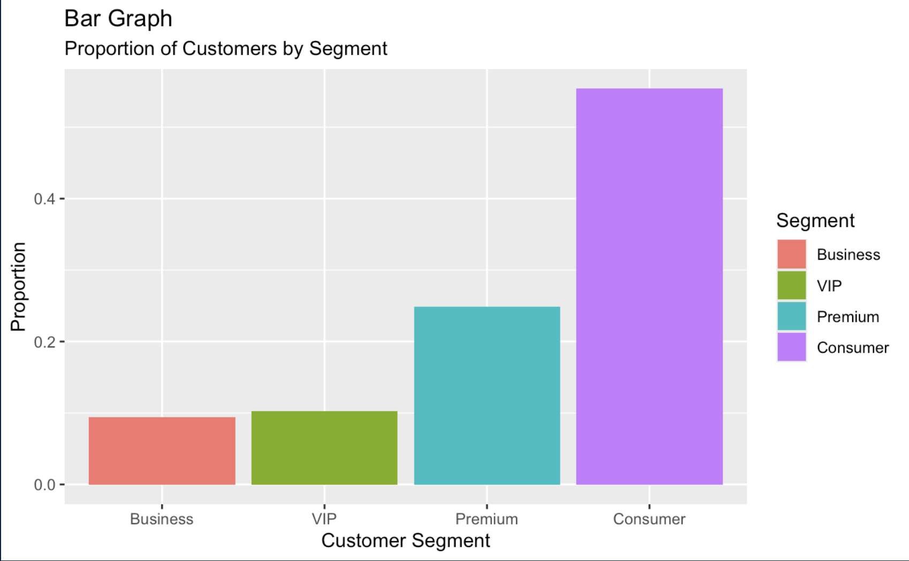
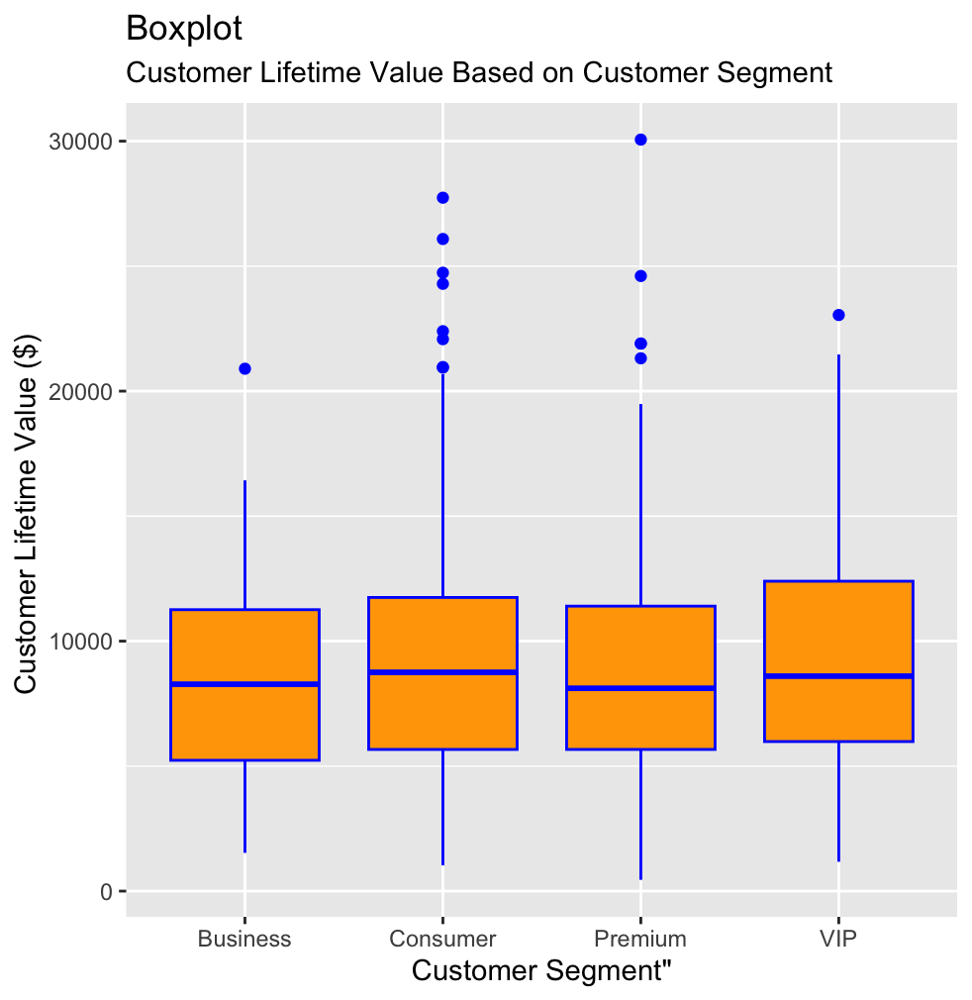
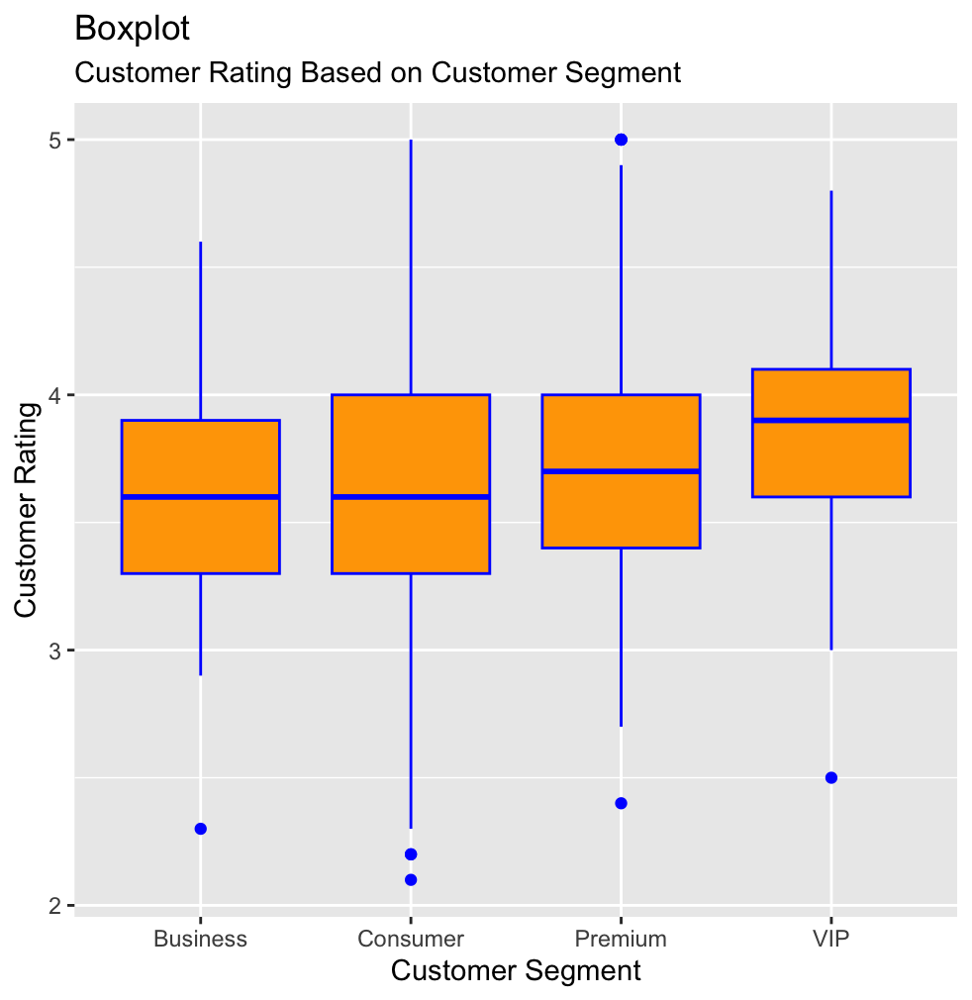
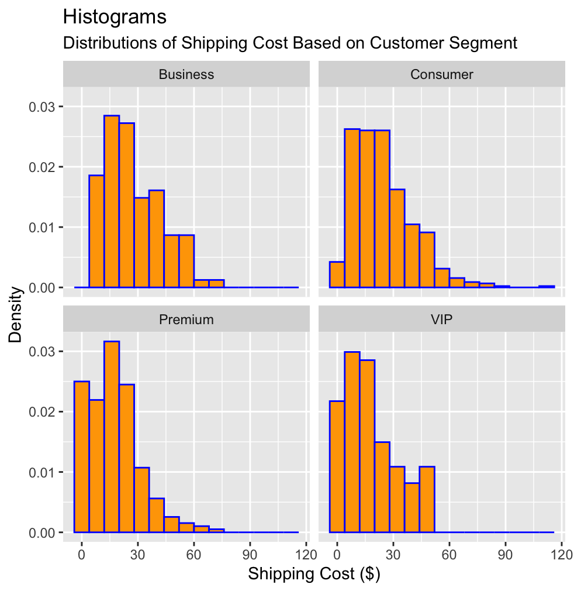

# Part 2: Customer Segment Analysis in E-Commerce (DATA 602)

> **Do higher-tier customers spend more, rate products higher, or pay less for shipping?**

[Back to main project](../)

**Presentation:** [View the slides (PDF)](reports/presentation.pdf)

---

## Business Problem

The store sorts customers into four tiers: **Consumer, Business, Premium and VIP**. Higher tiers usually get perks such as cheaper or free shipping, and those perks cost money. Before investing in moving customers up the tiers, the business needs to know what a higher-tier customer is actually worth.

We asked three questions. Do higher-segment customers:
1. **spend more money** over their lifetime?
2. **rate products better** on average?
3. **pay less for shipping**?

**Practical implication:** knowing what sets high-value customers apart tells the business how to keep them satisfied, how to attract more of them, and whether tier perks pay off.

## Data

We used the Kaggle [E-Commerce Sales and Customer Analytics](https://www.kaggle.com/datasets/datascikhan/e-commerce-sales-and-customer-analytics) dataset: 138,116 synthetic orders from 2021 to 2025. Rows with missing values were dropped, giving the **population**. We then took a **simple random sample of n = 1,000** transactions without replacement (`set.seed(30095675)`) for inference.

| Variable | Type | Role |
|---|---|---|
| `customer_segment` | Categorical (4 levels) | Predictor |
| `customer_lifetime_value` | Continuous (\$) | Response 1 |
| `customer_rating` | Continuous (1 to 5) | Response 2 |
| `shipping_cost` | Continuous (\$) | Response 3 |

## Exploratory Data Analysis

### Proportion of customers by segment

<p align="center">
  
</p>

About 55% of customers are Consumers, about 25% are Premium, and VIP and Business customers each make up about 10%.

### Customer lifetime value by segment

<p align="center">
  
</p>

Based on the graph above, the customer segments have approximately the same median and spread of customer lifetime value, with the Consumer segment having the most outliers.

### Customer rating by segment

<p align="center">
  
</p>

The first three customer segments have similar medians of around 3.7 and similar spreads of data. VIP customers, however, have the highest median customer rating at around 3.9. The graph suggests that VIP customers tend to have slightly higher customer ratings on average and a higher first quartile than the other segments. Consumers have the widest range between the lower and upper bounds.

### Shipping cost by segment

<p align="center">
  
</p>

The plot shows that Premium and VIP customers have more opportunities to receive free shipping, whereas Business customers appear to get no free shipping and Consumers rarely receive it.

## Statistical Methods

1. **Simple random sampling** (n = 1,000) to cut the population down to a workable size.
2. **One-way ANOVA**, fit as a linear regression `lm(response ~ customer_segment)` and tested with `anova()` at α = 0.05:
   - H₀: μ_Business = μ_Consumer = μ_Premium = μ_VIP
   - Hₐ: at least one segment's mean differs from another's
3. **95% z-confidence intervals** for each segment's mean. Because we had the full population, we used the known population σ.

## Results

| Question | ANOVA p-value | Decision |
|---|---|---|
| Does mean **lifetime value** differ by segment? | 0.3166 | Fail to reject H₀ |
| Does mean **customer rating** differ by segment? | 5.49 × 10⁻⁷ | Reject H₀ |
| Does mean **shipping cost** differ by segment? | 8.60 × 10⁻¹¹ | Reject H₀ |

### 95% Confidence Intervals by Segment

| Segment | Lifetime value (\$) | Customer rating | Shipping cost (\$) |
|---|---|---|---|
| Business | 7,558.71 to 9,252.58 | 3.53 to 3.71 | 24.01 to 30.43 |
| Consumer | 8,758.26 to 9,492.44 | 3.57 to 3.65 | 22.84 to 25.55 |
| Premium | 8,284.14 to 9,391.10 | 3.69 to 3.81 | 15.69 to 19.16 |
| VIP | 8,556.19 to 10,364.03 | **3.77 to 3.96** | **15.38 to 21.24** |

- **Lifetime value:** all four intervals overlap heavily, which supports the ANOVA result. There's no evidence that VIPs spend more.
- **Rating:** Premium's interval sits entirely above Consumer's, and VIP's sits above both Consumer's and Business's.
- **Shipping:** Premium and VIP intervals sit entirely **below** those of Consumer and Business.

## Conclusion & Business Takeaways

- **Higher-tier customers don't spend more.** Moving a customer to VIP won't directly raise revenue per customer.
- **Higher-tier customers rate products higher.** Better average ratings attract new customers, so upgrading tiers could **raise profit indirectly** through reputation.
- **Higher-tier customers pay less for shipping**, consistent with tier perks like free shipping. That's a real cost of the loyalty program, and it should be weighed against the rating benefit.

## Next Steps

- Test whether **shipping cost and customer rating are directly related**: do customers who pay less for shipping rate products higher?
- Separate **cause from correlation**: are higher-tier customers *given* cheaper shipping, or do they choose slower and cheaper delivery options?
- Extend to the demographic questions from the proposal (age, gender, order count vs. segment), and check ANOVA assumptions (normality, equal variance) with diagnostic plots or bootstrapping.

## Files

| File | Description |
|---|---|
| [`reports/presentation.pdf`](reports/presentation.pdf) | Presentation slides |
| [`reports/presentation.pptx`](reports/presentation.pptx) | Original PowerPoint file (download) |
| [`reports/project_proposal.pdf`](reports/project_proposal.pdf) | Proposal: domain, population, variables and planned methods |
| [`reports/statistical_analysis_report.pdf`](reports/statistical_analysis_report.pdf) | Full R Markdown report with code appendix |

## How to Run

The analysis is in R. The full code is in the appendix of [`statistical_analysis_report.pdf`](reports/statistical_analysis_report.pdf). The report itself loads about 50 packages, but the core analysis needs only base R, plus `ggplot2` for the plots. This minimal version reproduces the report's customer-rating result exactly (tested with R 4.5):

```r
sales = read.csv("../data/ecommerce_sales_customer_analytics_150k.csv")
sales_pop = na.omit(sales[, c("customer_segment", "customer_rating",
                              "customer_lifetime_value", "shipping_cost")])
sales_pop$customer_segment = as.factor(sales_pop$customer_segment)

set.seed(30095675)
sales_sample = sales_pop[sample(nrow(sales_pop), size = 1000, replace = FALSE), ]

anova(lm(customer_rating ~ customer_segment, data = sales_sample))
```

Expected output:

```
Response: customer_rating
                  Df  Sum Sq Mean Sq F value    Pr(>F)
customer_segment   3   7.422 2.47391  10.801 5.489e-07 ***
Residuals        996 228.137 0.22905
```

Replace `customer_rating` with `customer_lifetime_value` or `shipping_cost` to reproduce the other two tests.

---
**Authors:** Dawson Conlon & Ricky Doucette, DATA 602, University of Calgary, Fall 2026. Licensed under the [MIT License](../LICENSE).
